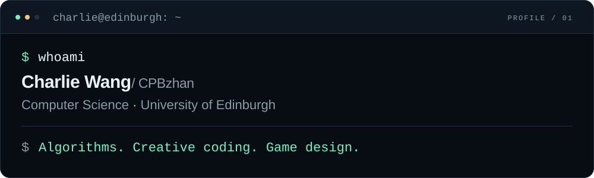
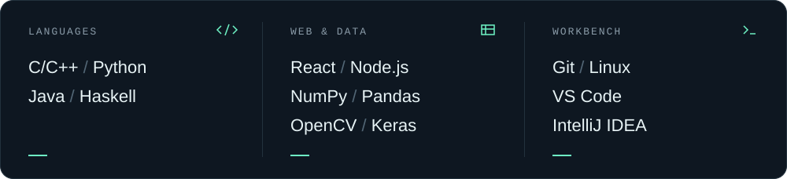
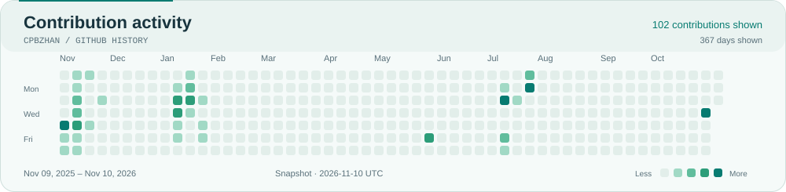
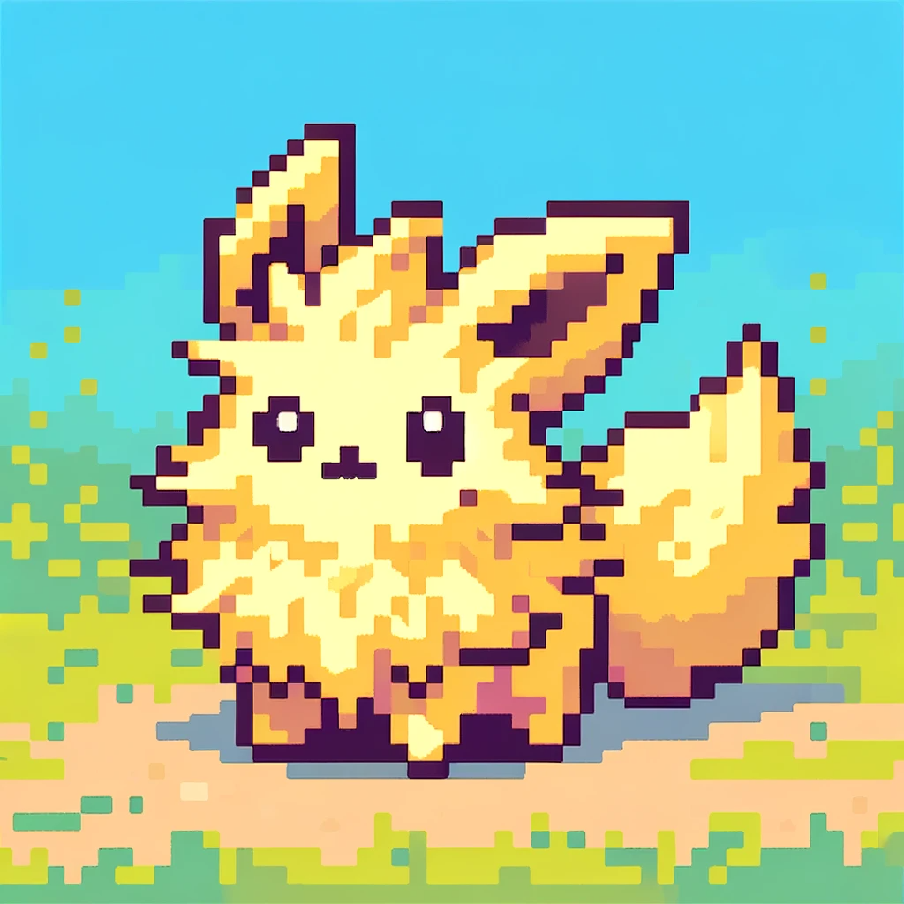
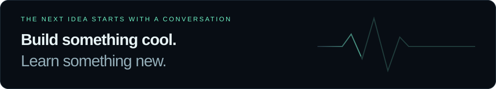

<picture>
  <source media="(max-width: 600px)" srcset="https://raw.githubusercontent.com/CPBzhan/CPBzhan/refs/heads/main/assets/hero-mobile.svg">
  
</picture>

  <a href="#selected-work">Selected work</a> &nbsp; / &nbsp;
  <a href="https://codeforces.com/profile/CPBzhan">Codeforces</a> &nbsp; / &nbsp;
  <a href="https://leetcode.com/u/CPBzhan/">LeetCode</a> &nbsp; / &nbsp;
  <a href="mailto:zehanw66@gmail.com">Get in touch ↗</a>

 

I'm **Charlie**, a Computer Science student at the **University of Edinburgh**. I like finding the idea behind an algorithm, turning maths into something you can see, and getting a little too invested in games.

<picture>
  <source media="(max-width: 600px)" srcset="https://raw.githubusercontent.com/CPBzhan/CPBzhan/refs/heads/main/assets/terminal-mobile.svg">
  
</picture>

 

## Selected work

### 01 &nbsp; AIGraph &nbsp; [↗](https://github.com/CPBzhan/AIGraph)

An interactive playground for geometry and functions, with local AI drawing through Ollama. Built on [Open-JSXGraph](https://github.com/blendviewer/open-jsxgraph).

`TypeScript` `Next.js` `JSXGraph` `Ollama`

---

### 02 &nbsp; L-System Fractal Generator &nbsp; [↗](https://github.com/CPBzhan/Inf1a/tree/main/Inf1ACompetation)

Simple rules, intricate worlds. An interactive Haskell project with animated growth, adjustable iterations and angles, and stochastic branching.

`Haskell` `Gloss` `Recursion` `Generative graphics`

  
<b>Watch it grow</b> · a demo from the project

   
  

---

### 03 &nbsp; LeetCode Solutions &nbsp; [↗](https://github.com/CPBzhan/leetcode-solutions)

My problem-by-problem collection of algorithm practice. One solution, one new pattern, one less mystery.

`C++` `Python` `Data structures` `Problem solving`

<a href="https://github.com/CPBzhan?tab=repositories">Explore all repositories →</a>

 

## Tools I reach for

<picture>
  <source media="(max-width: 600px)" srcset="https://raw.githubusercontent.com/CPBzhan/CPBzhan/refs/heads/main/assets/stack-mobile.svg">
  
</picture>

  
Text version

  - **Languages:** C / C++, Python, Java, Haskell
  - **Web & data:** HTML, CSS, JavaScript, React, Node.js, NumPy, Pandas, OpenCV, Keras
  - **Workbench:** Git, Linux, Windows, VS Code, Visual Studio, IntelliJ IDEA

 

## In motion

<a href="https://github.com/CPBzhan?tab=overview">
  <picture>
    <source media="(max-width: 600px)" srcset="https://raw.githubusercontent.com/CPBzhan/CPBzhan/refs/heads/main/assets/activity-mobile.svg">
    
  </picture>
</a>

Public contribution calendar · refreshed daily · <a href="https://github.com/CPBzhan?tab=overview">Full contribution history ↗</a>

 

  
<b>Off the clock</b> &nbsp; / &nbsp; player two has entered the chat

   
  
  
Usually gaming, trying out a new gadget, or thinking about how a game mechanic works.

  
Always happy to talk algorithms, game design, and interesting experiments.

  
Find me as <b>CPBzhan</b> on Codeforces and LeetCode.

   

 

<a href="mailto:zehanw66@gmail.com">
  <picture>
    <source media="(max-width: 600px)" srcset="https://raw.githubusercontent.com/CPBzhan/CPBzhan/refs/heads/main/assets/footer-mobile.svg">
    
  </picture>
</a>

  <a href="mailto:zehanw66@gmail.com">Gmail</a> &nbsp; · &nbsp;
  <a href="mailto:1511952898@qq.com">QQ Mail</a> &nbsp; · &nbsp;
  <a href="https://github.com/CPBzhan">@CPBzhan</a>

